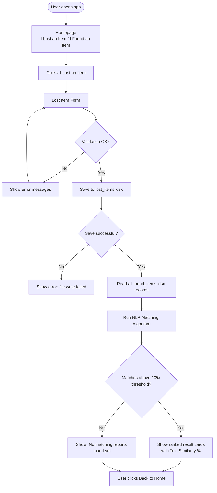

# FindIt — Complete Project Flow

## What the Project Does

FindIt is a college NLP project that lets students:
1. Report a **lost** item
2. Report a **found** item

After submission, it uses **TF-IDF + Cosine Similarity** to automatically find similar reports from the opposite list and ranks them by text similarity.

---

## Project File Structure

```
FindIt/
├── ui/
│   └── app.py           <- Streamlit UI (all pages, forms, results)
├── algorithm/
│   ├── __init__.py
│   └── matching.py      <- NLP engine + Excel read/write
├── excel/
│   ├── lost_items.xlsx  <- Stores all lost item reports
│   └── found_items.xlsx <- Stores all found item reports
├── requirements.txt
└── README.md
```

---

## Complete User Flow

### Flow A — Reporting a Lost Item



### Flow B — Reporting a Found Item

Identical flow to A, but:
- Report is saved to `found_items.xlsx`
- NLP searches `lost_items.xlsx` for matches
- Results show "Potential Lost Items"

---

## NLP Matching Pipeline (Step by Step)

### Step 1 — Text Preparation

All key fields from a report are combined into one string:

```
category + custom_item_name + item_name + color + brand + description + location
```

**Example (Lost Item):**
> "water bottle blue water bottle blue milton i lost my blue milton bottle with a black cap college library 2nd floor"

**Example (Found Item):**
> "water bottle milton water bottle blue milton blue stainless-steel bottle with a black lid central library second floor"

### Step 2 — Category Compatibility Filter

Before running TF-IDF, the algorithm checks:

| Query Category | Candidate Category | Compatible? |
|---|---|---|
| Water Bottle | Water Bottle | Yes (exact match) |
| Water Bottle | Laptop Charger | No (filtered out) |
| Other | Anything | Yes (use text to decide) |
| Anything | Other | Yes (use text to decide) |

This prevents a laptop charger from ever matching a water bottle report.

### Step 3 — TF-IDF Vectorisation

`TfidfVectorizer` from scikit-learn converts each text string into a numerical vector.

- Common words (like "the", "a") get **low weight**
- Rare, specific words (like "Milton", "black cap", "scratch") get **high weight**
- `ngram_range=(1, 2)` captures single words AND two-word phrases

```
"blue milton" -> higher weight than just "blue" or "milton" alone
```

### Step 4 — Cosine Similarity

The angle between the query vector and each candidate vector is measured.

```
Text Similarity (%) = cosine_similarity x 100
```

| Score | Meaning |
|---|---|
| 80-100% | Very similar descriptions |
| 40-79%  | Moderate overlap |
| 10-39%  | Weak overlap |
| < 10%   | Filtered out (below threshold) |

> This score measures **textual overlap only** — it does not guarantee the reports refer to the same physical item.

### Step 5 — Ranking and Threshold

- Results below **10%** are hidden
- Top **5** matches shown maximum
- Sorted from **highest to lowest** similarity

---

## Excel Storage

### lost_items.xlsx columns

| Column | Description |
|---|---|
| report_id | Auto-generated (e.g. L-A1B2C3D4) |
| item_category | Selected category |
| custom_item_name | Only when category = Other |
| item_name | Item title entered by user |
| color | Primary color |
| brand | Brand or model (optional) |
| description | Detailed description |
| location | Where item was lost |
| date_lost | Approximate date |
| submission_status | Department status |
| department_name | Dept name if applicable |
| created_at | Timestamp of submission |

### found_items.xlsx columns

Same as above except `date_lost` is replaced by `date_found`.

**Key rules:**
- Files are created automatically on first run
- New records are **appended** — existing data is never deleted
- Lost items are **only** compared against found items (never against other lost items)

---

## What Happens at Startup

```
streamlit run ui/app.py
       |
       v
init_excel_files()
  -> creates excel/lost_items.xlsx  (if missing)
  -> creates excel/found_items.xlsx (if missing)
       |
       v
Homepage displayed
```

---

## Matching: Worked Example

**Found item saved in Excel:**
- Category: Water Bottle
- Name: Milton Water Bottle
- Color: Blue
- Description: "Blue stainless-steel bottle with a black lid and a small scratch near the bottom."
- Location: Central Library, second floor

**User reports Lost item:**
- Category: Water Bottle
- Name: Blue Water Bottle
- Color: Blue
- Description: "I lost my blue Milton bottle with a black cap and a scratch near the bottom."
- Location: College library, second floor

**Result:** High similarity score (~70-85%) because both descriptions share "blue", "Milton", "bottle", "black", "scratch", "bottom", "library", "second floor" — all with TF-IDF weight.

**Unrelated item (Dell Laptop Charger):** Filtered out at Step 2 (category mismatch), score = 0, not shown.

---

## Technologies Used

| Library | Purpose |
|---|---|
| `streamlit` | Web UI — forms, pages, results display |
| `pandas` | Read/write Excel files, DataFrame operations |
| `openpyxl` | Excel engine used by pandas |
| `scikit-learn` | TfidfVectorizer + cosine_similarity |
| `Python stdlib` | os, sys, uuid, datetime, re |

---

## How to Run

```bash
# Navigate into the FindIt folder
cd path\to\FindIt

# Run the app
streamlit run ui/app.py
```

App opens at: **http://localhost:8501**
